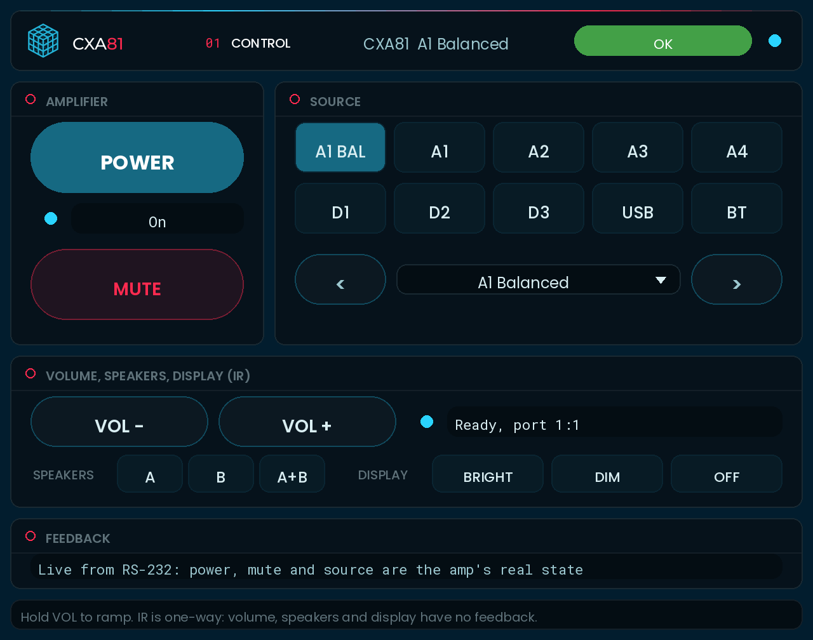
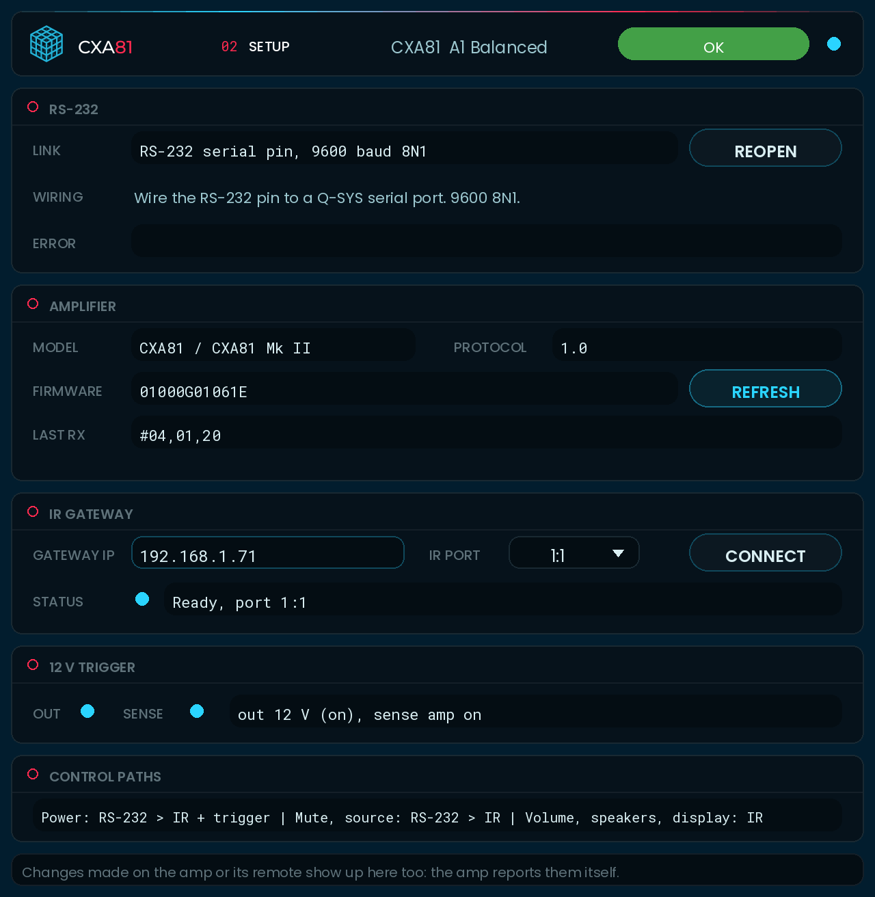

# Cambridge Audio CXA81 plugin for Q-SYS

`Cambridge_CXA.qplug` controls a Cambridge Audio CXA81 integrated amplifier (also the CXA81 Mk II and the CXA61) over any mix
of the control paths Cambridge Audio documents for it: **RS-232**, **IR** and the **12 V trigger**. Turn on any combination
in Properties. For each command the plugin uses the best path that's up, and falls back to the next one when it isn't.

## What each path can do

| | RS-232 | IR (through a gateway) | 12 V trigger |
|---|---|---|---|
| Power on / standby | Yes, with feedback | Yes (discrete on / off) | Yes (Trigger in) |
| Power feedback | Yes | No | Yes (Trigger out) |
| Mute | Yes, with feedback | Yes (discrete on / off) | |
| Source select, next, previous | Yes, with feedback | Yes (discrete codes) | |
| Volume up / down | **No** (not in the protocol) | Yes, tap or hold to ramp | |
| Speakers A / B / A+B | No | Yes | |
| Display bright / dim / off | No | Yes | |
| Firmware and protocol version | Yes | | |
| Sees front panel and remote changes | Yes, the amp reports them | No | Power only |

**Routing:** power goes RS-232 first, then IR, and the trigger output follows every power command when it's on. Mute and
source go RS-232 first, then IR. A mute, source or power command that RS-232 doesn't answer is sent again over IR, and so is
anything still waiting when RS-232 drops. Volume, speakers and display are IR only. The Setup page's **Control Paths** line
shows the routing for the paths you turned on.

**Feedback:** RS-232 is the truth when it answers. Without it, power comes from the trigger sense input if you wired one, and
everything else shows the last command the plugin sent. The Control page's **Feedback** line says which one you're seeing,
and an assumed power state shows as `On?` / `Standby?`.

**Not possible on the CXA81:** a volume level readout (IR is one-way and the serial protocol has no volume), balance, tone,
the setup menu (auto power down, USB audio class) and Bluetooth pairing. The CX **Control Bus** RCA sockets have no published
protocol, so the plugin doesn't use them. If you need a real volume level (a fader with a readout, presets, limits), run
the source through Q-SYS: set the amp's volume to a fixed level and control a Q-SYS gain block feeding the amp input.

## Install
1. Copy `Cambridge_CXA.qplug` to `Documents\QSC\Q-Sys Designer\Plugins`.
2. Restart Q-SYS Designer. The plugin appears under **Plugins > Audio > Cambridge Audio CXA81**.
3. Drag it into the design. Use one instance per amplifier.

## Set up
Pick the **Model** first (CXA81 / CXA81 Mk II, or CXA61). It sets the source buttons: the CXA81 has A1 Balanced, the CXA61
has MP3 instead. Then turn on the paths you have. RS-232 plus IR is the most capable mix.

### RS-232 (recommended, the only path with feedback for mute and source)
- **Serial (RS-232 pin)**: the plugin gets an `RS-232` serial pin. Wire it to a serial port in the design (a Core's RS-232
  port or a Q-SYS peripheral with one), and cable that port to the amp's RS232C socket. 9600 baud, 8N1. Serial ports only
  work on a Core, not in emulation.
- **TCP (serial-to-IP gateway)**: for an amp out of reach of a Q-SYS serial port. Set the gateway's serial side to 9600 8N1
  and its TCP side to raw pass-through, then type its IP and port on the **Setup** page. The plugin reconnects every 5 s.
- The manual doesn't give the RS232C connector's pinout or say whether it needs a straight or null-modem cable. If the
  Status says **No reply from amplifier** with a good port, try the other cable type.
- **Poll Interval** (default 10 s) only sets how fast the plugin notices the amp has gone quiet. Feedback doesn't wait for it.

### IR (for volume, speakers and display, and as a backup for everything else)
- Set **IR** to **Global Cache iTach (TCP 4998)**. Any gateway that speaks Global Caché's `sendir` on TCP 4998 should work,
  for example an iTach IP2IR.
- Put the gateway's IR emitter on the amp's front IR window, or wire its IR output to the amp's rear **IR in** socket. The
  manual says IR in takes modulated IR from a repeater or control system and doesn't give the connector or level, so start
  with an emitter on the window.
- On the **Setup** page, type the gateway's IP and pick the IR port (`1:1` to `1:3`, iTach numbering; the `IrPort` pin
  takes any `module:port` for other gateways). The plugin keeps the connection open, checks it every 30 s and reconnects on its own.
- **IR Code Set**: Cambridge Audio's two IR sheets disagree. The *CXA IR Remote Control Codes* sheet puts everything on RC-5
  system 16. The *CX Series Remote Control IR Codes* sheet puts power and display on system 25. **Both** (the default) sends
  power and display codes on both systems, which is safe because they're discrete. Once you know which one your amp uses,
  you can pick it to halve the IR traffic.
- **IR Power-On Wait** (default 3 s): with IR only, how long to wait after a power-on before sending a source code.

### 12 V trigger (optional)
- The manual says **Trigger in** takes 12 V from home automation to control the power state, and **Trigger out** gives a
  continuous 12 V while the CXA is on. Q-SYS can't make or read 12 V on its own, so the plugin exposes two pins:
  - `TriggerOut` (output, true = on) follows every power command. Wire it to a GPIO output or relay that switches 12 V into
    Trigger in.
  - `TriggerSense` (input) is power feedback. Wire the amp's Trigger out to a GPIO input that can take 12 V, and that input to
    `TriggerSense`.
- Set **12V Trigger** to Out, Sense, or Out and Sense, to match what you wired.

### Power On With Source (default Yes)
Picking a source while the amp is in standby powers it on first. Over RS-232, the source command waits for the amp to be
ready, retrying for up to 6 s while the amp answers "can't be actioned now" (`#00,04`). Over IR, it waits for the IR
Power-On Wait. Set it to **No** to get an error instead.

## Pages
| Page | What it shows |
|---|---|
| **Control** | **Power** (lit when on) with an On / Standby readout, **Mute**, ten source buttons in front-panel order, previous / next and a source list. With IR: **VOL -** / **VOL +** (tap for a step, hold to ramp), **Speakers** A / B / A+B, **Display** bright / dim / off and the IR status. A **Feedback** line saying where the shown state comes from. |
| **Setup** | Only the panels for the paths you turned on. **RS-232**: link, Connect / Reopen, gateway IP and port, last error. **Amplifier**: model, protocol and firmware version, Refresh, last message. **IR Gateway**: IP, IR port, Connect, status. **12 V Trigger**: out and sense LEDs. **Control Paths**: the routing. |

The header on every page shows the model, power, source and mute at a glance, the Q-SYS Status and an Online LED. Status is
**OK** when the configured paths are up. It's **Compromised** when RS-232 isn't answering but IR is covering for it, or when
RS-232 is fine but the IR gateway is down (so no volume). It's **Fault** when nothing can reach the amp.

The previews show every path turned on: RS-232 (serial), IR and the trigger.

**Properties:** Model, RS-232 (Off / Serial / TCP), IR (Off / Global Cache iTach), IR Code Set, IR Power-On Wait (s),
12V Trigger (Off / Out / Sense / Out and Sense), Power On With Source, Poll Interval (s), Debug Print.

**Pins:** most controls have pins. Useful ones for UCIs and scripts: `Power` (toggle), `PowerOn` / `PowerOff`, `Mute`,
`MuteOn` / `MuteOff`, `Source 1-10`, `SourceSelect` (source name), `SourceNext` / `SourcePrev`, `SourceCode` (the protocol's
source number, -1 when unknown), `VolumeUp` / `VolumeDown` (momentary: hold to ramp), `SpeakerA` / `SpeakerB` / `SpeakerAB`,
`DisplayBright` / `DisplayDim` / `DisplayOff`, `TriggerOut`, `TriggerSense`, `Online`.

## Codes

| Button | CXA81 RS-232 | CXA61 RS-232 | IR (RC-5 system 16) |
|---|---|---|---|
| A1 Balanced (CXA81) / A1 (CXA61) | 20 / 00 | 00 | 104 / 100 |
| A1 to A4 | 00 to 03 | 00 to 03 | 100 to 103 |
| D1, D2, D3 | 04, 05, 06 | 04, 05, 06 | 105, 106, 107 |
| MP3 (CXA61) | | 10 | 108 |
| USB Audio | 16 | 16 | 114 |
| Bluetooth | 14 | 14 | 115 |

Other IR commands: power on 14, off 15 (system 16 and/or 25), mute on 50, off 51, volume up 16, down 17, source up 99,
down 126, speakers A+B 30, A 35, B 39, display bright 18, dim 19, off 71 (system 16 and/or 25).

## How it works
- **RS-232:** messages are ASCII: `#`, group, comma, command number, optional data, carriage return. The document's examples
  sometimes drop the leading zero (`#1,01`), so replies are matched by number. One command is in flight at a time, and the
  plugin waits up to 1.5 s for its reply or error. Two unanswered commands in a row mark RS-232 down. Quick repeated source
  presses are merged, so only the last one goes out. Errors from the amp appear on the Setup page with the command that
  caused them.
- **IR:** each command is an RC-5 frame (36 kHz, 889 µs half-bits, field bit for codes 64 and up, toggle bit flipped on each
  new press), sent as Global Caché `sendir` pulse counts with 2 frames. Codes are queued and sent one at a time, each after
  the gateway's `completeir`. Volume: a tap sends one frame. Holding past 0.4 s resends the same code every 0.3 s with 4
  frames, which is Global Caché's documented way to keep a held code going smoothly. Releasing sends `stopir`. Gateway errors
  (`ERR_...`, `busyir`) show in the IR status.
- **Buttons** show the new state straight away, and RS-232 replies confirm it, or put it back after 2 s.

## Not tested on hardware
Tested in a Lua 5.3 harness against a simulated CXA81 that answers RS-232 per the protocol document and obeys IR frames
decoded from the plugin's `sendir` output through a simulated gateway. The harness covers: RS-232 only, RS-232 plus IR,
IR only, trigger only, all three over TCP, no path, RS-232 failing over to IR mid-session, an amp that only takes power on
system 25, power-on-with-source retries, volume holds, keepalive and reconnects. The previews are renderings, not Designer
screenshots. Check on site:
- **IR codes on a real CXA81.** Neither IR sheet names the CXA81, though it ships with the same CX remote. Check which
  system it uses for power and display, and whether it takes the discrete mute (50 / 51), speaker (30 / 35 / 39) and source
  codes. The manual only lists speaker switching on the front panel.
- What the amp accepts in standby, and how long it takes to accept commands after power-on.
- Whether **Trigger in** follows the level or switches on an edge (the manual doesn't say). The plugin holds `TriggerOut` at
  the wanted state.
- The RS-232 cable type, and the fonts and layout in Q-SYS Designer.
- The protocol document covers the CXA61 and CXA81. The CXA81 Mk II manual points to the same protocol, but it hasn't been
  checked on a Mk II.

## Sources
- Cambridge Audio, [CXA61 and CXA81 Serial Control Protocol v1.0](https://www.cambridgeaudio.com/sites/default/files/compliance/doc/AP366462%20CXA61%20CXA81%20Serial%20Control%20Protocol%20(1).pdf): serial settings, message format, commands, replies, source codes, errors, unsolicited updates.
- Cambridge Audio, [CXA IR Remote Control Codes](https://www.cambridgeaudio.com/sites/default/files/compliance/doc/CXA%20IR%20Remote%20Control%20Codes.pdf) (CXA60/80 sheet, listed with the CXA documents on the [driver and documents page](https://www.cambridgeaudio.com/row/en/driver-updates)): RC-5 system 16 codes.
- Cambridge Audio, [CX Series Remote Control IR Codes](https://supportarchive.cambridgeaudio.com/hc/en-us/article_attachments/18773756055581): power and display on system 25.
- Cambridge Audio, [CXA61/81/81 Mk II manual](https://www.cambridgeaudio.com/row/en/manuals/cxa618181-mk-ii): inputs per model, RS232C, IR in, trigger in / out, Control Bus, speakers A/B, display brightness.
- STMicroelectronics, [AN: implementing an RC5 infrared transmitter](https://www.st.com/resource/en/application_note/cd00229682-implementing-an-rc5-infrared-transmitter-using-the-ir-timer-modulator-of-the-stm8l10x-microcontroller-stmicroelectronics.pdf): RC-5 carrier, bit timing, frame layout, toggle bit.
- Global Caché, [Unified TCP API](https://www.globalcache.com/files/docs/api-gc-unifiedtcp.pdf): TCP 4998, `sendir`, `stopir`, `getdevices`, continuous repeat, error replies.
- QSC, [Q-SYS SerialPorts](https://help.qsys.com/Content/Control_Scripting/Using_Lua_in_Q-Sys/SerialPorts.htm), [TcpSocket](https://help.qsys.com/Content/Control_Scripting/Using_Lua_in_Q-Sys/TcpSocket.htm) and [plugin functions](https://help.qsys.com/DeveloperHelp/Content/Standards_Definitions/Reserved_Functions.htm) (`GetPins` with `Domain = "serial"`).

Not affiliated with or endorsed by Cambridge Audio, Global Caché or QSC.
