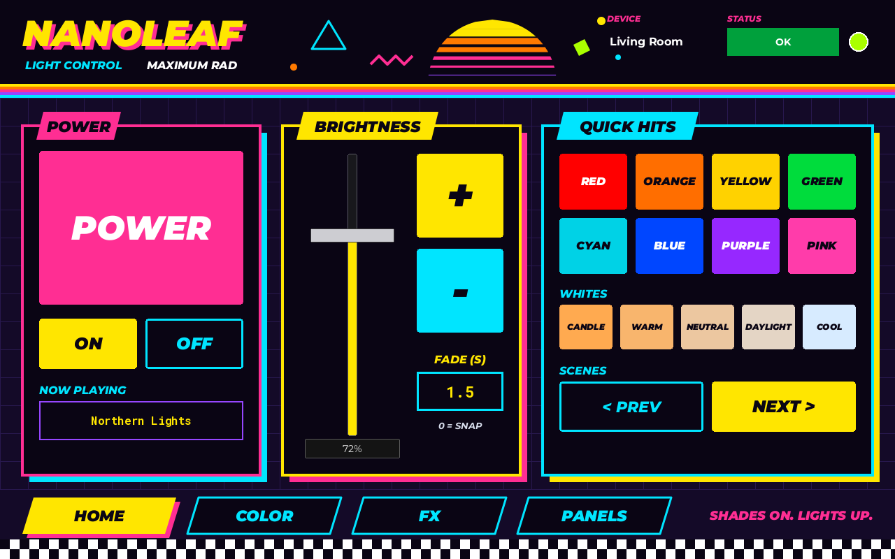
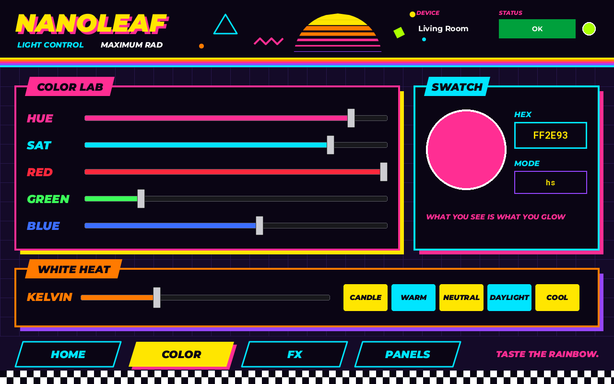
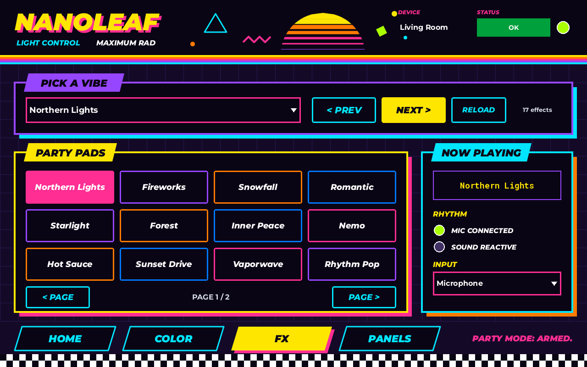
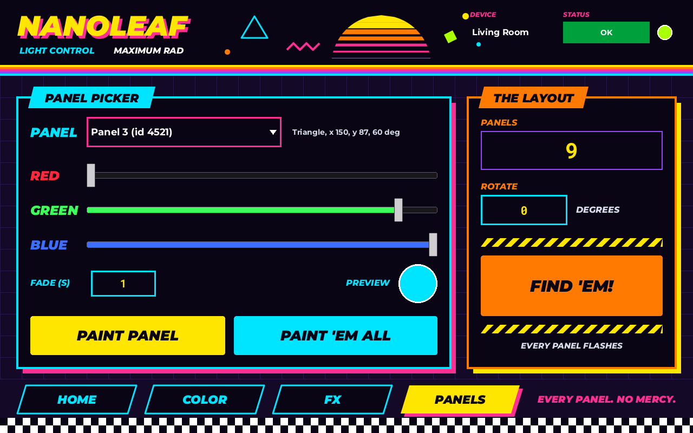

# Nanoleaf UCI for the Q-SYS TSC-101-G3

A four-page touchscreen UCI for Nanoleaf lights on a Q-SYS **TSC-101-G3**, in a loud 80s/90s look styled after the
[Pit Viper](https://www.pitviper.com) website: hot pink, electric yellow, cyan and orange on a purple-black field,
heavy slanted type, hard offset shadows, sunset stripes, a sliced retro sun, a grid and a checkerboard.

It drives the [Nanoleaf Open API plugin](../nanoleaf/) (version 1.2 or later). The pages are built into the plugin, so
there is nothing extra to install and no UCI script: you switch them on, copy them onto a UCI, and every control stays
linked to the plugin.

| Home | Color |
|---|---|
|  |  |
| **Effects** | **Panels** |
|  |  |

## The TSC-101-G3
From the QSC TSC Series G3 spec sheet: 10.1 in screen (10.07 in viewable), **1920 x 1200 native, 16:10**, landscape or
portrait wall mount (the table stand is landscape only), PoE+ Class 4. The pages are laid out at **1280 x 800**, the same
16:10 shape, landscape.

## Install
1. Install `Nanoleaf.qplug` 1.2 from [../nanoleaf/](../nanoleaf/) (copy it to `Documents\QSC\Q-Sys Designer\Plugins` and restart Designer).
2. Add the plugin to the design and pair it with your Nanoleaf as its README describes.
3. In the plugin's Properties, set **TSC-101 UCI Pages** to **On**. Four more pages appear in its page list: TSC Home, TSC Color, TSC Effects, TSC Panels.

## Set up the UCI
1. Add a UCI. In its Properties set **Panel Type** to TSC, model **TSC-101-G3**, orientation **Landscape**.
2. Set **Tabs: Location** to **None** before adding anything, because the pages draw their own tab bar. (QSC says to set tabs before adding controls.)
3. Add four UCI pages named Home, Color, FX and Panels.
4. For each page: open the plugin's control panel, pick the matching TSC page, press **Ctrl+A** (selects every control and the graphics) and paste onto the UCI page at the top-left corner (0, 0).
5. Make the tab bar work: drag a **Navigation Button** (Schematic Library > UCI Buttons) onto each drawn tab and set its Page. Size it to the slot below. Then either set its colors to fully transparent so the drawn tab shows through, or color it like the tab (lit tab: yellow `#FFE600` with black text; others: `#0A0514` with a cyan `#00E5FF` edge and text).
6. Assign the UCI to the TSC-101-G3 in the Touch Screen Status/Control component as usual.

| Tab | Goes to | Slot (x, y, w, h) |
|---|---|---|
| HOME | Home | 32, 712, 220, 52 |
| COLOR | Color | 268, 712, 220, 52 |
| FX | FX | 504, 712, 220, 52 |
| PANELS | Panels | 740, 712, 220, 52 |

The tabs are slanted, so a rectangular button covers a little more than the drawn sticker. Drawing a polygon and dropping the page onto it (QSC's polygon method) matches the slant exactly.

## Pages
| Page | What it does |
|---|---|
| **Home** | Big POWER toggle with On and Off; Now Playing; a tall brightness fader with a value box, big + and - steps and fade time; 8 quick colors; 5 white presets (Candle to Cool); previous and next scene |
| **Color** | Hue, saturation, red, green and blue faders; a live color swatch; hex entry; color mode; color temperature fader with the 5 white presets |
| **Effects** | Scene list; previous, next and reload; 12 effect pads that light the playing effect, with page buttons; Now Playing; Rhythm module and sound-reactive LEDs; mic/AUX input |
| **Panels** | Pick a panel, set its color with red, green and blue faders and a preview swatch, fade time, paint one panel or all of them; panel count; rotation; Identify (all panels flash) |

The header on every page shows the Nanoleaf's name, the plugin's Q-SYS status and an Online LED.
Pairing and IP setup are left off the touchscreen on purpose; they stay on the plugin's Setup page.

## The look, and what Q-SYS can't draw
Every color, shape and font is a documented Q-SYS layout property. The static artwork (field, grid, header, sun,
stripes, cards and their shadows, tab bar, checkerboard) is one SVG per page, built by the plugin so the lit tab and
the cards line up with the controls. Text is Q-SYS labels and controls on top.

| Color | RGB | Used for |
|---|---|---|
| Night | 20, 10, 40 | Page field |
| Ink | 10, 5, 20 | Cards, readouts, text on neon |
| Hot pink | 255, 46, 147 | Power, shadows, combo edges, slogans |
| Electric yellow | 255, 230, 0 | Main action buttons, wordmark, lit tab, readout digits |
| Cyan | 0, 229, 255 | Secondary buttons, editable fields, captions |
| Orange | 255, 122, 0 | Color temperature, Identify |
| Violet | 150, 70, 255 | Readout edges, effect card |
| Lime | 170, 255, 0 | LEDs |

Type is **Montserrat** Black Italic and ExtraBold Italic for headings and buttons, the heaviest slanted face on the
Q-SYS font list, and **Roboto Mono** Bold for numbers.

| Pit Viper look | Stand-in here |
|---|---|
| Sunset and chrome gradients | Flat color bands: the sun is sliced into yellow, orange, pink and violet bands, and the header has five flat stripes |
| Neon glow on type and boxes | A hard offset shadow: the wordmark has a pink copy behind it, and each card has a solid neon block offset 10 px |
| Chrome lettering | Flat light grey (214, 220, 235) |
| Blur, texture and photo backgrounds | None; a flat grid on the field instead |
| Custom display fonts | Montserrat Black Italic |

Effect pads each have their own neon edge (pink, violet, orange, blue) and fill with it when that effect is playing.
Quick-color and white-preset buttons show the color they send.

## Limitations / not tested on hardware
**These pages have not been loaded in Q-SYS Designer or shown on a real TSC-101-G3.** What was checked: the pages
were generated by the plugin's own layout code in a Lua 5.3 harness and rendered to the preview images here (a close
rendering, not a Designer screenshot); every control on them is an existing plugin control with the same pretty name
as on the plugin's own pages; and with the property Off the plugin's pages, controls and pins are identical to 1.1.
The plugin's runtime is unchanged, so its earlier harness tests still apply.

Check these on site:
- **Paste with graphics:** QSC says Ctrl+A in a control panel selects controls "including graphics". Check that the SVG artwork and labels paste onto the UCI and keep their position, and that controls keep their colors and fonts.
- **Canvas size:** QSC's help does not list the pixel size of the TSC-101-G3 Panel Type. If the UCI canvas is not 1280 x 800, use Panel Type Custom at 1280 x 800, or scale the pasted selection to fit.
- **SVG rendering:** the artwork uses only plain rectangles, polygons, circles and one path (no gradients, filters or text). Check that the TSC draws it crisply.
- **Fader value box:** the brightness fader uses `ShowTextbox`. Check where Designer puts the box on a vertical fader.
- **Button text on lit states:** Q-SYS buttons have one text color, so lit pads and the lit Power button use colors dark enough for a white legend. Check readability on the panel.
- **Navigation:** the tab bar is drawn artwork; it does nothing until you add Navigation Buttons (step 5 above).

Not included: a portrait version, and pairing or setup on the touchscreen.

## Sources
- QSC, TSC Series G3 specifications (TSC-101-G3 size, 1920 x 1200 native, 16:10, orientation, PoE+): https://in.qsc.com/resource-files/productresources/dn/touchscreen_controller_peripherals/q_dn_qsys_tsc-g3_specs.pdf
- Q-SYS Help, UCI Customization (Panel Type and TSC-101-G3 model, Tabs: Location and None, Navigation Buttons and the polygon method, copying controls from a control panel with Ctrl+A "including graphics"): https://help.qsys.com/Content/Schematic_Library/uci_customization.htm
- Q-SYS Help, UCI Design: https://help.qsys.com/Content/Schematic_Library/user_control_interface.htm
- Q-SYS plugin reserved functions (layout properties, `Svg` graphics with a Base-64 `Image`, `ZOrder`, `ShowTextbox`, the font list including Montserrat Black Italic and Roboto Mono): https://help.qsys.com/DeveloperHelp/Content/Standards_Definitions/Reserved_Functions.htm
- Style reference: https://www.pitviper.com (look and tone only; no logos, artwork or copy taken).

Not affiliated with or endorsed by QSC, Nanoleaf or Pit Viper.
