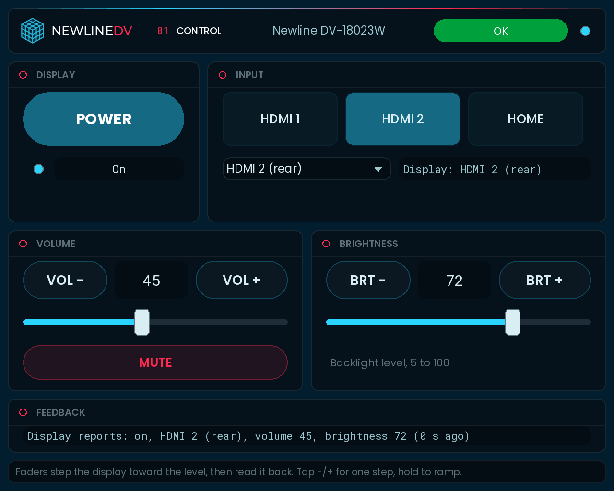
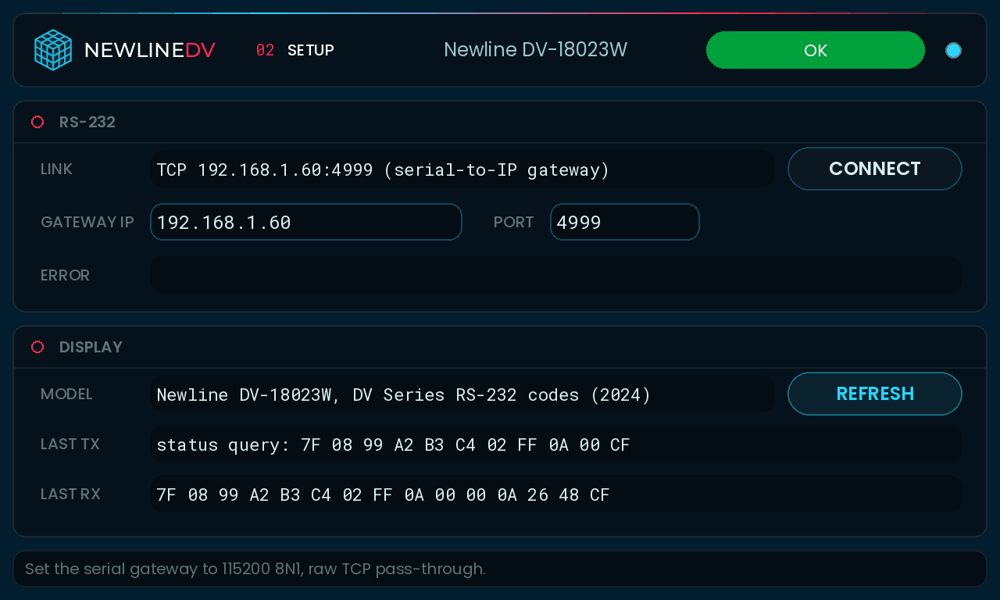

# Newline DV Series plugin for Q-SYS

`Newline_DV.qplug` controls a Newline **DV-18023W**, the 180 inch DV Series all-in-one direct view LED display, over
RS-232. The same plugin works for the 120 inch **DV-12023W** and the 150 inch **DV-15023W**: Newline's DV Series manual
covers all three, and one RS-232 code sheet covers the series. Newline's datasheets and resellers also list these
panels as **DV One** and **DV-xx023H / DV-xx023HD**.

## What it can do

| | How | Feedback |
|---|---|---|
| Power on / standby | Discrete commands | Yes, from the status query |
| Input: HDMI 1 (front), HDMI 2 (rear), Home (Android) | Discrete commands | Yes |
| Volume up / down | Step commands: tap for one step, hold to ramp | Yes, 0 to 100 |
| Volume fader | Steps toward the level, reads it back, repeats until it gets there | Yes |
| Mute | Steps the volume to 0, and back to where it was on unmute | Yes (volume 0 is the display's mute state) |
| Backlight brightness up / down and fader | Same as volume | Yes, 5 to 100 |
| Changes made with the remote or on the display | Picked up by polling | Within one poll interval |

**Not in Newline's protocol, so not in the plugin:** a set-volume or set-brightness command (only steps), a mute
command, other inputs, picture modes, the Android apps, and network control. The datasheet lists a LAN port, but Newline
doesn't publish a control protocol for it, so the plugin only uses RS-232. To control the display over the network, use
a serial-to-IP gateway (see below).

## Install
1. Copy `Newline_DV.qplug` to `Documents\QSC\Q-Sys Designer\Plugins`.
2. Restart Q-SYS Designer. The plugin appears under **Plugins > Displays > Newline DV Series**.
3. Drag it into the design. Use one instance per display.

## Set up
- **Model**: DV-18023W (default), DV-15023W or DV-12023W. It only changes the name shown; the protocol is the same.
- **Connection**:
  - **Serial (RS-232 pin)** (default): the plugin gets an `RS-232` serial pin. Wire it to a serial port in the design (a
    Core's RS-232 port or a Q-SYS peripheral with one), and cable that port to the display's RS232 port. The plugin opens
    it at **115200 baud, 8 data bits, no parity, 1 stop bit**, as the code sheet says. Serial ports only work on a Core,
    not in emulation.
  - **TCP (serial-to-IP gateway)**: for a display out of reach of a Q-SYS serial port. Set the gateway's serial side to
    115200 8N1 and its TCP side to raw pass-through, then type its IP and port on the **Setup** page. The plugin reconnects
    every 5 s.
  - Newline's documents don't give the RS232 connector's pinout or cable type. If the Status says **No reply from
    display** with a good port, try a null-modem cable or adapter.
- **Power On With Input** (default Yes): picking an input while the display is in standby turns it on first, then sends
  the input after **Boot Wait** (default 10 s), and resends it up to 3 times, 3 s apart, until the display reports it.
  Set it to No to only send the input.
- **Poll Interval** (default 5 s): how often the plugin asks the display for its state. This is the only way to see
  changes made with the remote, because the display doesn't report them by itself.

## Pages
| Page | What it shows |
|---|---|
| **Control** | **Power** (lit when on) with an On / Standby readout. Three input buttons and an input list, plus the input the display reports. **Volume**: VOL - / VOL + (tap or hold), the level, a fader and **Mute**. **Brightness**: the same for the backlight. A **Feedback** line with the display's last report and its age. |
| **Setup** | **RS-232**: link, Connect / Reopen, gateway IP and port (TCP only), last error. **Display**: model, Refresh, the last message sent and the last one received, in hex. |

The header on every page shows the model, the Q-SYS Status and an Online LED. Status is **OK** when the display answers,
**Initializing** until its first reply, and **Fault** when the port is closed or the display stops answering.

**Properties:** Model, Connection (Serial / TCP), Power On With Input, Boot Wait (s), Poll Interval (s), Debug Print.

**Pins:** most controls have pins. Useful ones for UCIs and scripts: `Power` (toggle), `PowerOn` / `PowerOff`,
`Input 1-3`, `InputSelect` (input name), `Volume` (0 to 100), `VolumeUp` / `VolumeDown` (momentary: hold to ramp), `Mute`,
`MuteOn` / `MuteOff`, `Brightness` (5 to 100), `BrightnessUp` / `BrightnessDown`, `Online`.

## Codes

From Newline's *DV Series RS-232 Codes* sheet. Every control message is `7F 08 99 A2 B3 C4 02 FF 01 cc CF`, and the display
answers `7F 09 99 A2 B3 C4 02 FF 01 cc 01 CF`.

| Function | cc |
|---|---|
| Power on / off | `00` / `01` |
| HDMI front / HDMI 1 | `0A` |
| HDMI rear 1 / HDMI 2 | `52` |
| Home page (Android) | `1C` |
| Volume - / + | `17` / `18` |
| Backlight brightness + / - | `47` / `48` |

Status query: `7F 08 99 A2 B3 C4 02 FF 0A 00 CF`. Reply: `7F 08 99 A2 B3 C4 02 FF 0A 00 AB EF GH OP CF`, where `AB` is
power (`00` on, `01` off), `EF` the source (`0A`, `52` or `1C` as above), `GH` the volume in hex (`00` to `64`, `00` is the
mute state) and `OP` the backlight in hex (`05` to `64`).

## How it works
- **One message on the wire at a time.** Each command waits up to 1 s for its reply. Three unanswered messages in a row
  mark the display offline. Quick repeated input or power presses are merged, so only the last one goes out.
- **Replies are matched on the fixed header and function byte.** The sheet prints the status reply with the same `08`
  length byte as the query, so the plugin doesn't rely on the length byte. It also skips an echoed query, for gateways
  that echo.
- **Faders.** The protocol has no "set level" command, so a fader move sends up to 4 steps toward the target, queries
  the real level, and repeats. It learns how far one step moves the level from those readings, so it still lands
  correctly if a step is bigger than 1. It gives up with a message on the Setup page if the level stops changing (for
  example in standby) or after 30 s.
- **Hold to ramp.** A tap sends one step. Holding longer than 0.4 s sends a step every 0.1 s, each after the previous one
  is answered. Releasing reads the level back.
- **Buttons** show the new state straight away, and the next status reply confirms it or puts it back after 2 s.

## Not tested on hardware
Tested in a Lua 5.3 harness against a simulated display that answers per the code sheet. The harness covers serial and
TCP, power, inputs, fader moves with 1-step and 5-step displays, mute and unmute, tap and hold, changes made on the
display, a display that stops answering and comes back, replies split across reads, echoed queries, commands refused in
standby, and power-on with input. The previews are renderings, not Designer screenshots. Check on site:
- **Whether the display answers in standby.** The sheet doesn't say. If it doesn't, the plugin shows **No reply from
  display** while the display is off, and power-on still works only if the display accepts the command in standby.
- **How much one volume or brightness step moves the level**, and how fast the display accepts steps. The plugin adapts
  to the step size; lower the ramp rate in the code if the display drops steps.
- **How long the display takes to boot** before it takes an input command. Set **Boot Wait** to match.
- The RS232 connector and cable type, and the fonts and layout in Q-SYS Designer.
- The DV-18023W itself. The code sheet says "DV Series" without model numbers, and the manual that lists the DV-18023W
  doesn't mention RS-232. The datasheet for the same 180 inch panel (DV-18023HD) lists RS232.

## Sources
- Newline Interactive, [DV Series RS-232 Codes (2024)](https://newline-interactive.com/wp-content/uploads/2024/06/DV-Series-RS-232-Codes-2024-1.pdf): serial settings, control codes, replies, status query and its fields.
- Newline Interactive, [DV Series User Manual](https://www.manualslib.com/manual/3575226/Newline-Dv-Series.html) (via ManualsLib, covers DV-12023W, DV-15023W, DV-18023W and DV One): inputs, home screen, settings.
- Newline Interactive, [DV One datasheet](https://newline-interactive.com/wp-content/uploads/2024/11/Newline-DV-One-1.pdf): models DV-12023HD / 15023HD / 18023HD, interfaces "HDMI x2, USB 2.0 x 2, USB 3.0, SPDIF out, LAN; RS232".
- QSC, [Q-SYS SerialPorts](https://help.qsys.com/Content/Control_Scripting/Using_Lua_in_Q-Sys/SerialPorts.htm), [TcpSocket](https://help.qsys.com/Content/Control_Scripting/Using_Lua_in_Q-Sys/TcpSocket.htm) and [plugin functions](https://help.qsys.com/DeveloperHelp/Content/Standards_Definitions/Reserved_Functions.htm).
